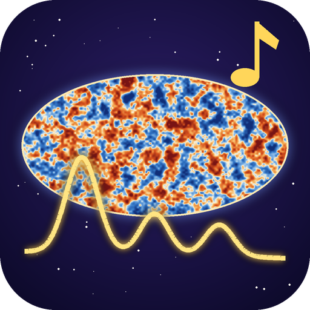

<p align="center"></p>

# Notes of the Big Bang

*Measure the acoustic peaks of the cosmic microwave background from the Planck maps — and hear them* — original Italian name: «Le note del Big Bang»

Downloads the Planck PR3 SMICA-noSZ half-mission maps and common mask, computes the cross power spectrum (free of noise bias) with healpy, finds the acoustic peaks and troughs, and derives the geometry of the Universe and the density of ordinary matter. The peaks become **notes** you can listen to. It also shows the Sun's dipole and the sky in Planck's nine frequencies.

## Features

* Nside 512 / 1024 / 2048, Mollweide maps, residual point-source power estimated and removed
* Error bars from 20 simulated skies; ℓ up to 2000
* Downloads resume from IRSA if the ESA archive drops (3 × 201 MB)
* PDF/PNG card and CSV/JSON in English, WAV of the notes

## Tested on real data

Six peaks at ℓ = 221.7 ± 3.2 / 535.8 / 810.0 / 1113.9 / 1406.1 / 1692.5 (ΛCDM: 220 / 538 / 807 / 1113 / 1405 / 1695); Ω_tot = 0.988 ± 0.030 (flat); Ω_b h² = 0.0227 ± 0.0004 (Planck: 0.0224).

> **Language note.** The interface is in **Italian** (large, adjustable text); plots, PDF/PNG cards and scientific output are in **English**. Code comments are in Italian. The original Italian guide is [`LEGGIMI.txt`](LEGGIMI.txt).

**Version:** 1.4 (2026-11-20). **Status:** Stable: 1.4 built and installed (self-test 36/36, diagnostics 18/18).

## Quick start

Requirements: Python 3.10+ (tested with Python 3.14 on Ubuntu) with `tkinter` (Ubuntu: `sudo apt install python3-tk`).

```bash
git clone https://github.com/EDOKILLER/notes-of-the-big-bang.git
cd notes-of-the-big-bang
python3 -m pip install -r requirements.txt

python3 note_big_bang.py --autotest
python3 note_big_bang.py --diagnostica
python3 note_big_bang.py        # opens the window
```

### Standalone executable

`bash crea_eseguibile_ubuntu.sh` builds a single-file executable with PyInstaller in a temporary virtual environment, runs the self-test, and adds the program with its icon to the application menu and the desktop (first time on GNOME: right-click → *Allow launching*).

The build scripts were written for the author's machine: check the paths at the top before running them.

## Data sources and acknowledgements

Data are downloaded at run time from public services. If you publish results, please follow their acknowledgement policies:

* [Planck Legacy Archive (ESA), mirrored at IRSA](https://pla.esac.esa.int/)
* [NASA/IPAC Infrared Science Archive: 2MASS, WISE, Spitzer, Euclid, Planck](https://irsa.ipac.caltech.edu/)

This project is independent and not endorsed by any of these institutions.

## License

Code: [BSD 3-Clause](LICENSE) © 2026 Edoardo Battistel. You can use, modify and redistribute it, also commercially, as long as you keep the copyright notice; the author's name may not be used to promote derived works without permission. If you use it in research, see [`CITATION.cff`](CITATION.cff).

---
Part of a series of astronomy programs by Edoardo Battistel — see also [X-rays from Black Holes](https://github.com/EDOKILLER/x-rays-from-black-holes) and the other repositories on [this profile](https://github.com/EDOKILLER?tab=repositories).
